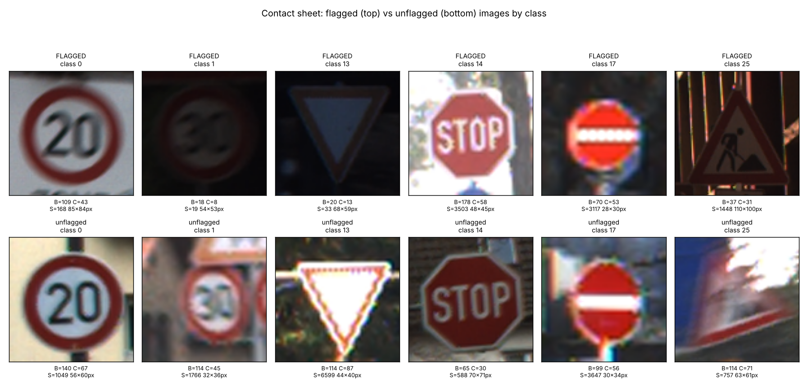
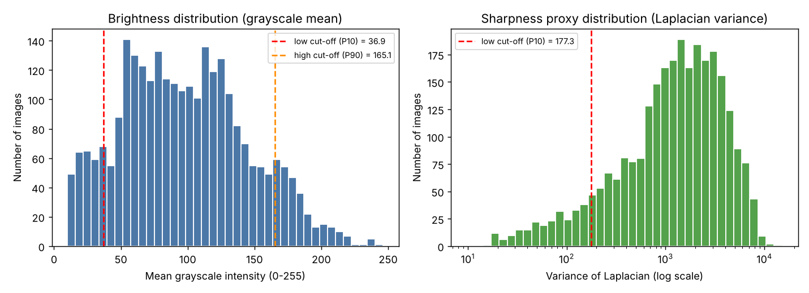
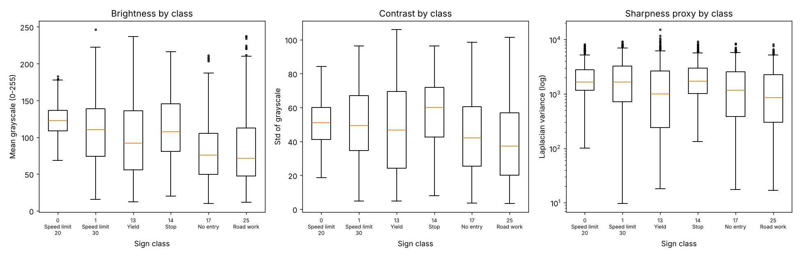
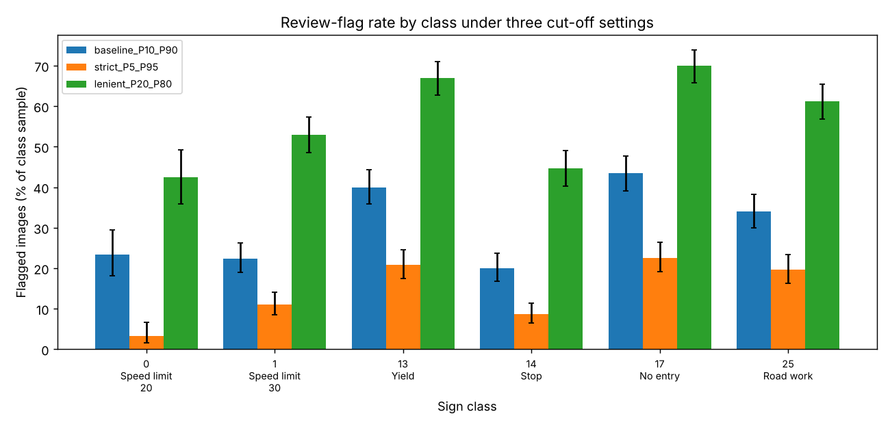
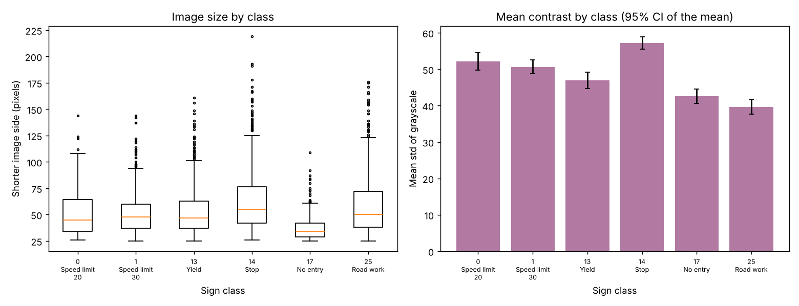
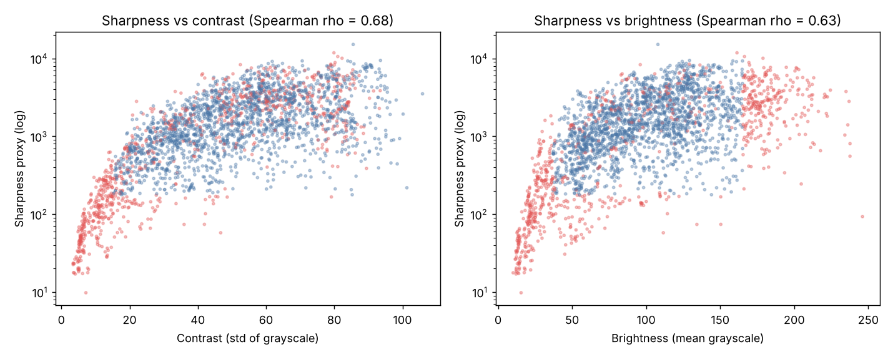
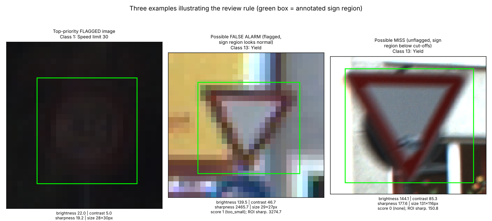
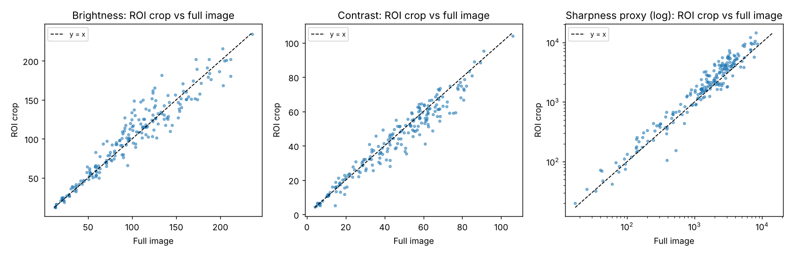

# Traffic Sign Visibility Audit - Analysis Report

*Author: Saad Saeed ALRuwaili | Course: Advanced AI Programming and Frameworks | Dataset: GTSRB | Seed: 42*

## 1. Case question
Road-safety analysts cannot inspect every traffic-sign photograph manually. **Which images should be reviewed first, and what
evidence supports that priority?** The audit measures brightness, contrast and a sharpness proxy with OpenCV, builds a
transparent percentile-based rule with NumPy, and compares classes with pandas. The flag is a **triage aid only**: it is not proof
that a sign is unsafe, unreadable or misclassified. No deep-learning model is used.

## 2. Data and preparation
**Source.** German Traffic Sign Recognition Benchmark (GTSRB), Real-Time Computer Vision Group, Ruhr-Universität Bochum
(https://benchmark.ini.rub.de/gtsrb_dataset.html; archival copy: https://zenodo.org/records/13741936).
Citation: Stallkamp, J., Schlipsing, M., Salmen, J., Igel, C. (2012). *Man vs. computer: Benchmarking machine learning algorithms
for traffic sign recognition.* Neural Networks, 32, 323-332. The archive is not redistributed in this repository.

**Full-dataset counts (all annotation rows, not sampled).**
39,209 annotation rows from 1 CSV file(s) covering 43 classes.

Data types after loading: Filename: str, Width: float64, Height: float64, Roi.X1: float64, Roi.Y1: float64, Roi.X2: float64, Roi.Y2: float64, ClassId: Int64.

| Check | Count |
|---|---|
| Duplicate rows | 0 |
| Duplicate image paths | 0 |
| Invalid image paths (file missing) | 0 |
| Invalid class IDs | 0 |
| Invalid dimensions | 0 |
| Invalid or absent ROI | 0 |
| Missing values (all columns) | 0 |

**Scope and sampling (separate from the full counts).** Selected classes: 0 (Speed limit 20), 1 (Speed limit 30), 13 (Yield), 14 (Stop), 17 (No entry), 25 (Road work).
For each selected class, up to 500 images were drawn at random (seed 42); the image-metric analysis therefore covers
**2,710 images**. Ineligible rows (missing file, invalid class) are never dropped silently: they are written to
`outputs/processed/exclusion_log.csv`. Images with an invalid/absent ROI are kept; only their ROI measures are NaN.
Skipped-file counters: none.

| stage | reason | count |
|---|---|---|
| annotation_file | image paths contained a foreign prefix; the first 1 path component(s) were ignored when locating files | 1 |

**Class counts: full vs sample.**

| class_id | class_name | n_full | n_sampled |
|---|---|---|---|
| 0 | Speed limit 20 | 210 | 210 |
| 1 | Speed limit 30 | 2220 | 500 |
| 13 | Yield | 2160 | 500 |
| 14 | Stop | 780 | 500 |
| 17 | No entry | 1110 | 500 |
| 25 | Road work | 1500 | 500 |

## 3. Feature definitions
OpenCV loads colour images in BGR; images are converted to RGB before display with Matplotlib.

| Feature | Definition | Unit |
|---|---|---|
| brightness_gray | Mean of the grayscale image (cv2.cvtColor BGR2GRAY) | intensity, 0-255 |
| contrast_gray | Standard deviation of the grayscale image | intensity, 0-255 |
| sharpness_lapvar | Variance of cv2.Laplacian(gray, CV_64F) - a PROXY for sharpness, not a human readability score; depends on image size/noise | unit-less (intensity^2) |
| brightness_hsv_v | Mean of the Value channel of HSV | intensity, 0-255 |
| width / height | Pixel size of the loaded image | pixels |
| min_side_px | min(width, height) | pixels |
| aspect_ratio | width / height | ratio |
| roi_* (brightness/contrast/sharpness) | Same three measures computed on the annotated sign region (ROI crop), when the ROI is valid | as above |

## 4. Review-priority rule (project-specific, not a safety standard)
An image meets a condition if it is **too dark** (brightness < P10), **overexposed** (brightness > P90),
**low contrast** (< P10), **blurry by proxy** (sharpness < P10) or **small** (shorter side < P10).
Percentiles are computed on the analysed sample with `np.percentile`; flags are vectorised boolean masks and `np.select`.
`priority_score` = number of conditions met; `review_flag` = score >= 1; tiers: high (>=3), medium (2), low (1).

Baseline cut-offs: brightness 36.9 / 165.1, contrast 15.2,
sharpness 177.3, shorter side 30px.
The baseline flags **848 of 2,710 images (31.3%)**: 181 high, 89 medium priority.

**Sensitivity check (three cut-off settings).**

| scenario | brightness_low | brightness_high | contrast_low | sharpness_low | min_side_low | n_flagged | pct_flagged |
|---|---|---|---|---|---|---|---|
| baseline_P10_P90 | 36.89 | 165.12 | 15.24 | 177.28 | 30.0 | 848 | 31.29 |
| strict_P5_P95 | 24.05 | 179.56 | 10.39 | 83.41 | 28.0 | 420 | 15.5 |
| lenient_P20_P80 | 55.43 | 136.94 | 25.97 | 401.84 | 33.0 | 1568 | 57.86 |

## 5. Findings
**Q1 - Class sizes and imbalance.** Among the selected classes the largest in the full data is 1 (Speed limit 30)
(2,220 images) and the smallest 0 (Speed limit 20) (210); ratio 10.6:1.
Capping at 500 per class reduces but does not remove this imbalance (sample sizes: 500 vs 210).
Small classes give wide confidence intervals for flag rates (Figure 4), and global percentile cut-offs are dominated by larger classes.

**Q2 - Size, brightness, contrast, sharpness across classes.** Share of variance explained by class (eta-squared; rule-of-thumb labels):

| feature | eta_squared | effect_size |
|---|---|---|
| min_side_px | 0.115 | medium |
| brightness_gray | 0.103 | medium |
| contrast_gray | 0.069 | medium |
| log10_sharpness | 0.076 | medium |

Class medians:

| class_id | class_name | n_images | min_side_px_median | brightness_gray_median | contrast_gray_median | sharpness_lapvar_median |
|---|---|---|---|---|---|---|
| 0 | Speed limit 20 | 210 | 45.0 | 122.6 | 51.09 | 1668.88 |
| 1 | Speed limit 30 | 500 | 48.0 | 110.34 | 49.36 | 1664.43 |
| 13 | Yield | 500 | 47.0 | 92.18 | 46.64 | 1001.47 |
| 14 | Stop | 500 | 55.0 | 107.33 | 60.02 | 1713.14 |
| 17 | No entry | 500 | 34.0 | 75.64 | 42.04 | 1170.77 |
| 25 | Road work | 500 | 50.0 | 71.1 | 37.29 | 863.52 |

Features whose class effect is "medium" or "large" are the ones where class differences matter for review priority; "negligible/small"
differences are dominated by within-class spread (Figure 3, Figure 5).

**Q3 - Flag rate by class and ranking stability.** Baseline flag rates (%):

| class_id | class_name | n_images | n_flagged | flag_rate_pct | ci95_low_pct | ci95_high_pct |
|---|---|---|---|---|---|---|
| 0 | Speed limit 20 | 210 | 49 | 23.33 | 18.12 | 29.5 |
| 1 | Speed limit 30 | 500 | 112 | 22.4 | 18.96 | 26.26 |
| 13 | Yield | 500 | 200 | 40.0 | 35.8 | 44.35 |
| 14 | Stop | 500 | 100 | 20.0 | 16.73 | 23.73 |
| 17 | No entry | 500 | 217 | 43.4 | 39.12 | 47.78 |
| 25 | Road work | 500 | 170 | 34.0 | 29.98 | 38.26 |

Highest baseline rate: 17 (No entry) (43.4%); lowest: 14 (Stop) (20.0%).
Class ranks under the three settings (1 = highest flag rate):

| class_id | baseline_P10_P90 | strict_P5_P95 | lenient_P20_P80 |
|---|---|---|---|
| 0 | 4 | 6 | 6 |
| 1 | 5 | 4 | 4 |
| 13 | 2 | 2 | 2 |
| 14 | 6 | 5 | 5 |
| 17 | 1 | 1 | 1 |
| 25 | 3 | 3 | 3 |

Spearman rank correlation with the baseline ranking - strict_P5_P95: rho = 0.83; lenient_P20_P80: rho = 0.83. The class with the highest flag rate is
the same in all settings.
Most common main reason among flagged images: **low_sharpness**.

**Q4 - Association between sharpness, contrast and brightness (Spearman).**
Sharpness vs contrast: rho = 0.68 (strong); sharpness vs brightness: rho = 0.63 (strong).
This describes how the measures move together in this sample; it does **not** show causation (image size, noise, compression
processing and scene content also affect all three measures).

**Q5 - Illustrative examples.** Figure 7 shows the top-priority flagged image and two heuristic cases found by checking the ROI crop against
the same cut-offs. Among images with a valid ROI, 326 of 848 flagged images have a sign region
that looks normal (possible **false alarms**, e.g. dark background), and 72 of 1862 unflagged images
have a sign region below a cut-off (cases the whole-image rule may **miss**). These are heuristics, not ground truth.

**ROI crop vs full image (small sample).**

| feature | mean_full | mean_roi | mean_abs_diff | spearman_full_vs_roi |
|---|---|---|---|---|
| brightness_gray | 99.065 | 101.987 | 10.544 | 0.956 |
| contrast_gray | 46.341 | 44.48 | 4.255 | 0.959 |
| sharpness_lapvar | 2063.826 | 2705.587 | 785.914 | 0.952 |

## 6. Figures

*Random flagged/unflagged example per class (seeded). B=brightness, C=contrast, S=Laplacian-variance sharpness proxy. Images are resized only for display; flagged images are triage candidates, not verdicts.*

*Distributions over the analysed sample with the baseline project-specific cut-offs (percentiles of this sample; not safety standards). Sharpness is strongly right-skewed, hence the log axis.*

*Class-wise distributions. Boxes show median and IQR; points are outliers. Compare the spread within a class with the shift between classes before calling a difference meaningful (see eta-squared table).*

*Share of sampled images flagged per class. Error bars: 95% Wilson intervals (wider when a class has fewer images). Compare bar heights with the intervals before reading differences as real.*

*GTSRB images vary strongly in size; small images carry fewer pixels and are harder to inspect. Contrast bars show mean +/- 1.96 SE.*

*Red = flagged, blue = unflagged. Spearman rho describes a monotonic association only; it does not show that low contrast or brightness causes low sharpness (image size and noise are confounders).*

*Left: highest-priority flagged image. Middle/right: heuristic false-alarm and missed-case candidates, found by comparing ROI-crop measures with the same cut-offs. These labels are illustrative, not ground truth.*

*Random sample of 200 images with valid ROI. Points off the diagonal show where the background changes the whole-image measure.*

## 7. Decision memo (one page)
**To:** Road-safety review team | **Re:** How to prioritise manual review of GTSRB-style sign photographs

**Recommendation.** Review in this order: (1) the 181 *high-priority* images (three or more conditions); (2) the 89 *medium* images
(two conditions); (3) single-condition images, starting with `low_sharpness`, the most common reason. Use `outputs/processed/review_queue.csv`
(sorted by score, then lowest sharpness). Spot-check a small random sample of *unflagged* images each cycle to estimate what the rule misses.

**Where to look.** Highest baseline flag rates: 17 (No entry) 43.4%, 13 (Yield) 40.0%.
This ordering is stable across the alternative cut-offs.
Prefer the stricter setting (strict_P5_P95) when review capacity is small and the lenient setting when missing a poor image is costly.

**Evidence that would change this recommendation.** (a) A human-labelled subset showing that flagged images are not more often hard to read than
unflagged ones; (b) unstable class rankings under more cut-off settings; (c) ROI-based measures disagreeing strongly with whole-image measures
(then switch the rule to ROI crops); (d) data from local roads in different lighting/weather.

**Limitations.** See Section 8. The cut-offs are project-specific percentiles, not safety standards, and a flag is not a safety verdict.

## 8. Limitations
1. **Sample:** at most 500 images per selected class, only 6 of 43 classes; results do not generalise to unselected classes. GTSRB contains
   several frames of the same physical sign (tracks), so images are not fully independent.
2. **Sharpness is a proxy:** Laplacian variance depends on image size, noise and texture, and is not a human readability score; small images are partly
   flagged because of their size.
3. **Percentile cut-offs are relative:** they always flag a fixed share of the sample, even if all images were acceptable; they are not safety thresholds.
4. **Dataset scope:** GTSRB shows German roads; it does not represent every local road environment, camera, or weather condition.
5. **Whole-image measures include background:** the sign region may differ (see ROI comparison); the ROI heuristic used for examples is not ground truth.

## 9. Reproducibility
Seed 42; relative paths only; derived tables in `outputs/processed/`, figures in `outputs/figures/`. Re-run with `python run_audit.py`.
