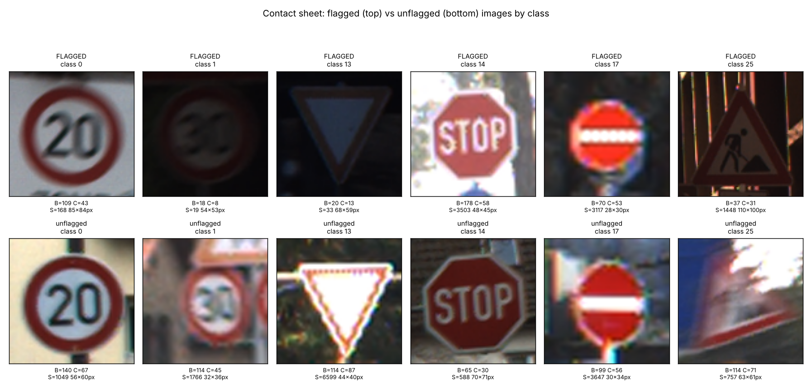
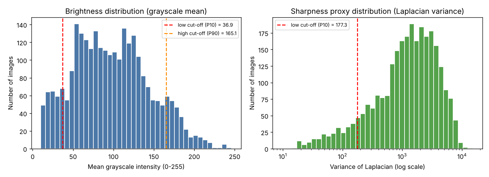
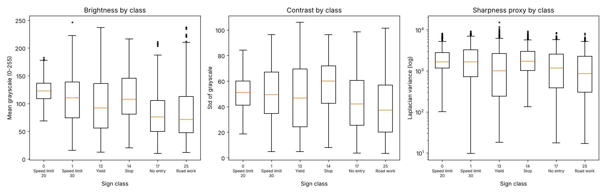
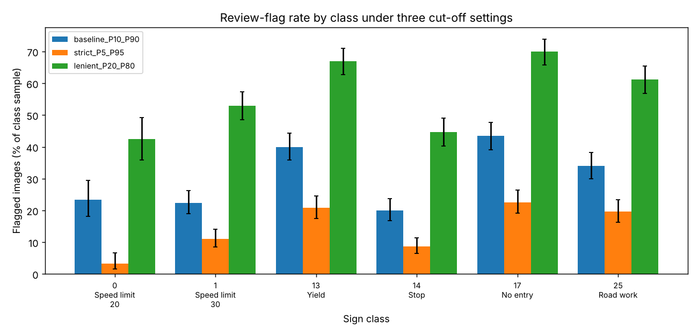
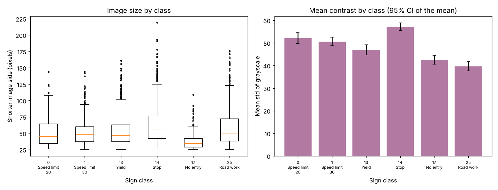
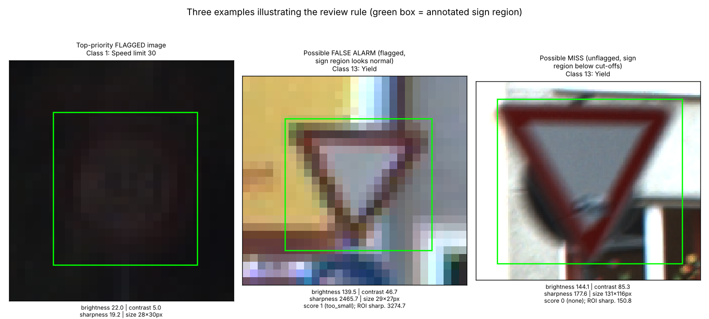

## 1. Case question
Which traffic-sign images should a human review first, and what evidence supports that priority? The audit measures brightness, contrast and a sharpness proxy with OpenCV, builds a transparent percentile rule with NumPy, and compares classes with pandas and Matplotlib. The flag is a **triage aid only**; it does not prove that a sign is unsafe, unreadable or misclassified. No deep-learning model is used.

## 2. Data and preparation
**Source.** German Traffic Sign Recognition Benchmark (GTSRB), Real-Time Computer Vision Group, Ruhr-Universität Bochum (<https://benchmark.ini.rub.de/gtsrb_dataset.html>; archival copy <https://zenodo.org/records/13741936>). Cite: Stallkamp, Schlipsing, Salmen and Igel (2012), *Man vs. computer: Benchmarking machine learning algorithms for traffic sign recognition*, Neural Networks 32, 323-332. The archive is not redistributed.

**Full dataset (not sampled).** 39,209 annotation rows, 43 classes. Checks: duplicate rows 0, missing values 0, invalid image paths 0, invalid class IDs 0, invalid dimensions 0, invalid or absent ROI 0. Column types: Width, Height and ROI corners float64 (after coercion), ClassId Int64, Filename string. The Kaggle-style `Train.csv` stores paths from another computer; the foreign first path component was ignored and logged. Nothing was dropped silently (`exclusion_log.csv`); ROI coordinates are validated before cropping.

**Sample (separate from the full counts).** Six classes, up to 500 random images each (seed 42): **2,710 images**, 0 skipped. Class 0 has only 210 images, so the sample keeps all of them; the other classes are capped, which reduces but does not remove the imbalance (full-data ratio 2,220 : 210 = 10.6 : 1).

## 3. Feature definitions
OpenCV reads images in BGR; they are converted to RGB only for Matplotlib display.

| Feature | Definition | Unit |
|---|---|---|
| Brightness | mean of the grayscale image | 0-255 |
| Contrast | standard deviation of the grayscale image | 0-255 |
| Sharpness (proxy) | variance of `cv2.Laplacian(gray, CV_64F)`; depends on size and noise, not a human readability score | unit-less |
| Size | shorter image side | pixels |
| ROI versions | same three measures on the annotated sign crop (valid ROI only) | as above |

## 4. Review-priority rule (project choice, not a safety standard)
An image meets a condition if it is too dark (brightness < P10), overexposed (> P90), low contrast (< P10), blurry by proxy (sharpness < P10) or small (shorter side < P10). Percentiles are computed on the sample with `np.percentile`; flags are vectorised NumPy masks and `np.select`. Priority score = number of conditions met; flagged = score >= 1 (high >= 3, medium 2, low 1). Baseline flags **848 of 2,710 images (31.3%)**: 181 high, 89 medium priority.

| Setting | Dark < | Bright > | Low contrast < | Blurry < | Small < | Flagged | % flagged |
|---|---|---|---|---|---|---|---|
| Baseline | 36.89 | 165.12 | 15.24 | 177.28 | 30.0 | 848 | 31.29 |
| Strict | 24.05 | 179.56 | 10.39 | 83.41 | 28.0 | 420 | 15.5 |
| Lenient | 55.43 | 136.94 | 25.97 | 401.84 | 33.0 | 1568 | 57.86 |

*Sensitivity check: strict (P5/P95) and lenient (P20/P80) settings change how many images are flagged by a factor of about four, which is why the cut-offs must be labelled as project choices.*

## 5. Findings
{width=6.3in}

**Q1 - Class sizes and imbalance.** Largest class: 1 Speed limit 30 (2,220 images); smallest: 0 Speed limit 20 (210). Small classes have wider confidence intervals (Figure 4), and sample-wide percentile cut-offs are dominated by the larger classes.

**Q2 - Size, brightness, contrast, sharpness by class** (medians; Figures 3 and 5).

| Class | Full | Sample | Size (px) | Bright. | Contrast | Sharp. |
|---|---|---|---|---|---|---|
| 0 Speed limit 20 | 210 | 210 | 45 | 122.6 | 51.1 | 1669 |
| 1 Speed limit 30 | 2220 | 500 | 48 | 110.3 | 49.4 | 1664 |
| 13 Yield | 2160 | 500 | 47 | 92.2 | 46.6 | 1001 |
| 14 Stop | 780 | 500 | 55 | 107.3 | 60.0 | 1713 |
| 17 No entry | 1110 | 500 | 34 | 75.6 | 42.0 | 1171 |
| 25 Road work | 1500 | 500 | 50 | 71.1 | 37.3 | 864 |

Class explains a medium share of variance for every feature (eta-squared: size 0.115, brightness 0.103, contrast 0.069, log-sharpness 0.076), so class differences matter for review priority. The largest gaps: No entry has the smallest images (34 px) and Road work the darkest and least sharp ones.

{width=6in}

{width=6.3in}

**Q3 - Flag rate by class and ranking stability.**

| Class | Baseline % (95% CI) | Strict % | Lenient % | Rank base/strict/lenient |
|---|---|---|---|---|
| 0 Speed limit 20 | 23.3 (18.1-29.5) | 3.33 | 42.38 | 4/6/6 |
| 1 Speed limit 30 | 22.4 (19.0-26.3) | 11.0 | 53.0 | 5/4/4 |
| 13 Yield | 40.0 (35.8-44.4) | 20.8 | 67.0 | 2/2/2 |
| 14 Stop | 20.0 (16.7-23.7) | 8.6 | 44.6 | 6/5/5 |
| 17 No entry | 43.4 (39.1-47.8) | 22.6 | 70.0 | 1/1/1 |
| 25 Road work | 34.0 (30.0-38.3) | 19.6 | 61.2 | 3/3/3 |

{width=5.4in}

No entry is ranked first and Yield second under all three settings; the other ranks move (Spearman with the baseline ranking: strict 0.83, lenient 0.83). Stop has the lowest baseline rate (20.0%). The most common main reason among flagged images is **low sharpness** (271 images).

{width=6in}

**Q4 - Association (Spearman).** Sharpness vs contrast: rho = 0.68; sharpness vs brightness: rho = 0.63. Both are strong and positive in this sample: darker or flatter images also tend to score lower on the sharpness proxy. This is an association, not causation; size, noise and scene content affect all three measures.

**Q5 - Three illustrative images (Figure 6).** Left: the highest-priority flagged image. Middle and right: a possible false alarm and a possible miss, found by checking the ROI crop against the same cut-offs. Among images with a valid ROI, 326 of 848 flagged images have a sign region that looks normal (possible false alarms, e.g. dark background), and 72 of 1862 unflagged images have a sign region below a cut-off (cases the rule may miss). ROI and full-image measures agree well (Spearman 0.95-0.96), though ROI sharpness is higher on average. These are heuristics, not ground truth.

{width=6.1in}

## 6. Decision memo
**To:** road-safety review team. **Recommendation.** Review in this order: (1) the 181 high-priority images (three or more conditions); (2) the 89 medium-priority images; (3) single-condition images, starting with low sharpness. Use `outputs/processed/review_queue.csv` (sorted by score, then lowest sharpness) and spot-check a small random sample of unflagged images each cycle to estimate what the rule misses. **Where to look:** the highest baseline flag rates are No entry (43.4%) and Yield (40.0%), and this ordering is stable across the three settings. Use the strict setting when review capacity is small and the lenient one when missing a poor image is costly. **What would change the recommendation:** (a) a human-labelled subset showing that flagged images are not harder to read than unflagged ones; (b) unstable class rankings under more cut-off settings; (c) ROI measures disagreeing strongly with whole-image measures, which would justify switching the rule to ROI crops; (d) data from local roads in other lighting and weather.

## 7. Limitations
1. **Sample:** at most 500 images per class and only 6 of 43 classes; GTSRB contains several frames of each physical sign (tracks), so images are not independent.
2. **Sharpness is a proxy:** Laplacian variance depends on image size, noise and texture; small images are partly flagged because of their size.
3. **Percentile cut-offs are relative:** they flag a fixed share of any sample, even if all images were acceptable, and are not safety thresholds.
4. **Scope:** GTSRB shows German roads and does not represent every local road environment, camera or weather condition.
5. **Whole-image measures include background;** the false-alarm and miss counts are heuristics without human labels.

*Reproducibility: seed 42, relative paths, derived tables in `outputs/processed/`, figures in `outputs/figures/`; the repository also contains Figure 6 (sharpness vs contrast and brightness) and an ROI-versus-full-image figure not reproduced here.*
